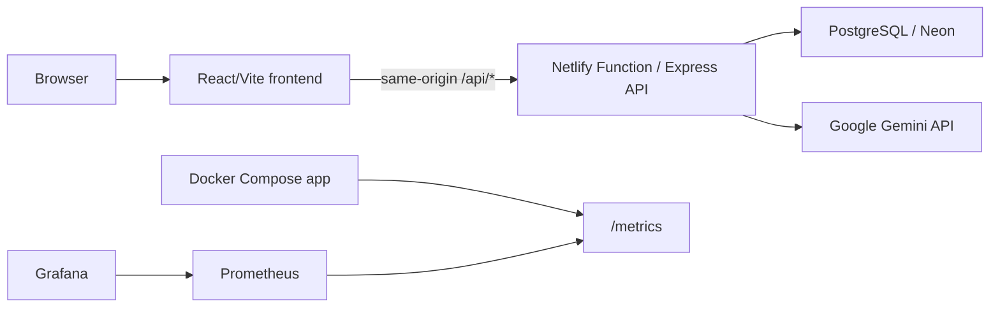

# ZenGen — Teen Mental Health Support Platform

ZenGen is a web-based mental-health support platform for teenagers. It combines a structured self-assessment with rule-based scoring, supportive AI-generated guidance, and educational resources. It is an awareness and support tool, not a clinical diagnostic service.

## Deployment status

**Netlify deployment is not live yet.** No public application URL is claimed because this workspace is not authorized to access a Netlify site. Once a Netlify site is authorized, configure the required private environment variables and deploy the application; add the verified HTTPS URL here after checking it.

**Source:** [Mohammedyouse/ZenGen-Prediction_of_mental-health_Platform](https://github.com/Mohammedyouse/ZenGen-Prediction_of_mental-health_Platform)

## Features

- Mood, anxiety, and social-wellbeing self-assessment.
- Rule-based scoring and risk classification, with AI-generated explanatory feedback.
- Supportive AI chatbot.
- PostgreSQL-backed accounts, assessment history, chat messages, and resources.
- Prometheus metrics endpoint and an optional provisioned Grafana monitoring dashboard.

## Technology

- React, TypeScript, Vite, Tailwind CSS
- Node.js and Express
- PostgreSQL with Drizzle ORM and Neon serverless
- Google Gemini API
- Docker Compose, Kubernetes, Ansible, GitHub Actions, Prometheus, and Grafana
- Netlify Functions adapter (`serverless-http`) for the Express API

## Architecture



## Local setup

Requirements: Node.js 20 or later, npm, and access to a PostgreSQL database.

1. Clone the repository and install its locked dependencies:

   ```sh
   git clone https://github.com/Mohammedyouse/ZenGen-Prediction_of_mental-health_Platform.git
   cd ZenGen-Prediction_of_mental-health_Platform
   npm ci
   ```

2. Create a local `.env` from `.env.example` and fill in the values locally. Do not commit `.env`.

3. If the database schema needs to be initialized, review the Drizzle schema and the target database before applying it:

   ```sh
   npm run db:push
   ```

4. Start the development server:

   ```sh
   npm run dev
   ```

   The application is served at `http://localhost:5000`.

## Environment variables

Provide these values in a local ignored `.env` file or in the hosting provider's private environment-variable settings. This repository contains names and placeholders only; never put secret values in source code or Git.

| Variable | Purpose |
| --- | --- |
| `DATABASE_URL` | PostgreSQL/Neon connection string used by the application and PostgreSQL session store |
| `SESSION_SECRET` | Secret used to sign authentication session cookies; required in production |
| `GEMINI_API_KEY` | Server-side API key for Gemini-generated assessment feedback and chatbot responses |

See [.env.example](./.env.example) for the variable names.

## Build and checks

```sh
npm ci
npm run check
npm test
npm run build
```

`npm run check` runs the TypeScript compiler. `npm test` exercises the HTTP metrics middleware with real local HTTP requests. `npm run build` builds the Vite frontend and bundles the Express server; a successful build is separate from the test result.

## DevOps and monitoring

- GitHub Actions runs dependency installation, TypeScript checking, and the production build on pushes and pull requests to `main`. Kubernetes manifest validation and a separate Kind rollout/rollback demonstration are also configured in the repository.
- The related [DevOps CA-II repository](https://github.com/Mohammedyouse/DevOps-CA2_2023_27) contains the course case study and monitoring evidence.
- [Dockerfile](./Dockerfile) builds the production application image. The monitoring stack is defined in [`devops/monitoring`](./devops/monitoring/).
- Prometheus scrapes the ZenGen `/metrics` endpoint. The provisioned Grafana dashboard includes uptime, total requests, request rate, p95 latency, and error-rate panels.
- Kubernetes Deployment and Service manifests are in [`devops/kubernetes`](./devops/kubernetes/). The Deployment expects a Kubernetes Secret named `zengen-secrets`; do not commit that Secret's values.
- An Ansible playbook and inventory are in [`devops/ansible`](./devops/ansible/). The playbook is configuration, not proof that it has been executed or tested for idempotency.

After creating a private `.env`, create/update the Kubernetes Secret without printing its values, then apply the manifests:

```sh
kubectl create secret generic zengen-secrets --from-env-file=.env --dry-run=client -o yaml | kubectl apply -f -
kubectl apply -f devops/kubernetes/deployment.yaml
kubectl apply -f devops/kubernetes/service.yaml
kubectl rollout status deployment/zengen-deployment
```

Start the local monitoring stack from the repository root:

```sh
docker compose --env-file .env -f devops/monitoring/docker-compose.yml up -d
docker compose --env-file .env -f devops/monitoring/docker-compose.yml ps
```

Grafana is available at `http://localhost:3000`, Prometheus targets at `http://localhost:9090/targets`, and application metrics at `http://localhost:5000/metrics`.

## Netlify requirements and limitations

The Vite frontend is a static site; the Express API, database-backed sessions, PostgreSQL access, and Gemini integration require the included Netlify Function adapter and private production configuration. The Netlify configuration builds the frontend and routes the API to the function. A static-only deploy would **not** provide these backend features.

Before deployment, authorize the Netlify CLI/site and configure `DATABASE_URL`, `SESSION_SECRET`, and `GEMINI_API_KEY` as private production environment variables in Netlify. The local Netlify build and function routes can be smoke-tested, but the public site, production database/session behavior, and live Gemini response remain unverified until authorized deployment and production testing.

## Mental-health support notice

ZenGen is intended for awareness and supportive education. It does not provide a clinical diagnosis and should not replace advice from a qualified mental-health professional.
